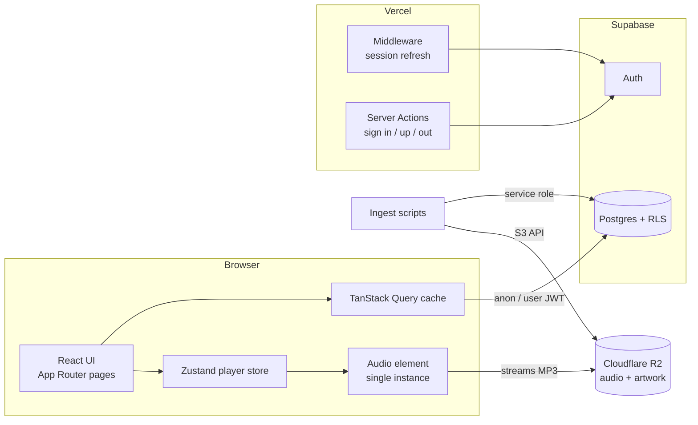
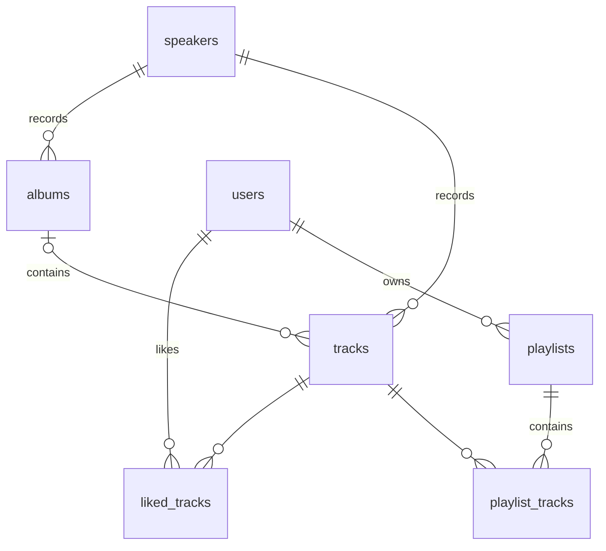

# KKS Audio

> **Note:** The source code for this project is in a private repository. This public repo holds only the README, to describe the project, its architecture and the technical decisions behind it. The app itself is live at [app.kadambafoundation.com](https://app.kadambafoundation.com/).

A streaming web app for the lectures, kirtans and music of Kadamba Kanana Swami, built for the [Kadamba Foundation](https://app.kadambafoundation.com/).

**Live:** [app.kadambafoundation.com](https://app.kadambafoundation.com/)

KKS Audio takes a large archive of recordings that used to sit in a media database and makes it easy to listen to. You get a Spotify-style player that keeps playing while you browse, scripture series in canonical order, topic-based discovery, and personal libraries of liked tracks and playlists.

---

## Features

**Listening**
- Playback never stops when you navigate. A single `<audio>` element lives in the root layout and is driven by a global store.
- Queue-based playback with next/previous, shuffle (the current track stays put, the rest is randomised with Fisher–Yates, and turning shuffle off restores the original order), and repeat modes `off` / `all` / `one`.
- "Previous" restarts the current track if you're more than 3 seconds in, like most music players.
- Desktop gets a persistent player bar. Mobile gets a mini-player that expands into a full-screen player with artwork.

**Browsing and discovery**
- **Categories** match the Foundation's media database: Srimad Bhagavatam, Caitanya Caritamrta, Kirtan Mela, Music Albums and more.
- **Albums** are studio music releases with cover art and track listings. Ordered series play by track number; unordered collections play newest first.
- **Search** across title, recording location and tags. It runs on the client with deferred rendering and incremental "show more" paging.
- **Curated topic cards** such as Mercy, Chanting, Ratha Yatra and Humility filter the catalog by tag.
- A **New additions** row on the home page shows recently ingested tracks.

**Personal library (signed-in users)**
- Email and password auth through Supabase.
- **Liked Songs** with optimistic updates: the heart fills instantly and rolls back if the write fails.
- **Playlists**: create, rename, delete, and add or remove tracks from anywhere in the app. A playlist can mix tracks across categories and albums.

**Polish**
- Responsive layout: a collapsible sidebar on desktop and a bottom tab bar on mobile.
- Light and dark themes (dark by default).
- Route transitions animated with Motion.
- Data for album and category links is prefetched just before the cards scroll into view, so most navigations feel instant.

---

## Tech stack

| Layer | Choice |
| --- | --- |
| Framework | [Next.js 16](https://nextjs.org/) (App Router), React 19, TypeScript |
| Styling / UI | Tailwind CSS v4, [shadcn/ui](https://ui.shadcn.com/) on Base UI primitives, Lucide icons, `next-themes` |
| Animation | [Motion](https://motion.dev/) |
| Client state | [Zustand](https://zustand.docs.pmnd.rs/) for the player |
| Server state | [TanStack Query v5](https://tanstack.com/query) for catalog, likes and playlists |
| Database & auth | [Supabase](https://supabase.com/) (Postgres + Row Level Security + Auth via `@supabase/ssr`) |
| Media storage | [Cloudflare R2](https://developers.cloudflare.com/r2/) (S3-compatible, served from a public bucket URL) |
| Ingestion | Node scripts run with `tsx`, using the AWS S3 SDK, `csv-parse`, `music-metadata` and `yt-dlp` |
| Hosting | [Vercel](https://vercel.com/) |

---

## Architecture



### Playback engine

Playback is split between **intent** and **effect**:

- `src/lib/player/store.ts` is a Zustand store that holds the current track, the queue, the original (unshuffled) queue, play/pause state, volume, and repeat and shuffle modes. UI components only ever call store actions such as `playTrack`, `next` and `seek`.
- `src/components/player/AudioController.tsx` renders the app's only `<audio>` element. It's mounted in the root layout, so it never unmounts across route changes. It subscribes to the store and syncs the element with it: it swaps the `src` when the track changes, calls `play()` or `pause()`, and sets the volume. It also reports `timeupdate`, `loadedmetadata` and `ended` back to the store.
- Seeking uses a **`seekToken` counter** rather than writing `currentTime` directly. `currentTime` updates several times a second from the element itself, so the store bumps a token for each explicit seek request, and the controller applies `seekTarget` once per token. Explicit seeks then never fight the element's own progress updates.
- If the browser blocks autoplay, the `play()` promise rejection resets `isPlaying` to `false`, so the UI never shows a "playing" state that isn't real.

### Data fetching

- Catalog reads go through shared fetch functions in `src/lib/catalog-queries.ts`. They accept any typed `SupabaseClient<Database>`, so the same code runs against the browser client or a server client.
- Query keys are kept in one `catalogKeys` object. The query client uses a 5-minute `staleTime`: the catalog changes rarely, so pages served from cache are the norm.
- `usePrefetchOnVisible` uses an `IntersectionObserver` with a 200px root margin to warm the cache for a link just before it's on screen.
- User data (likes, playlists) is scoped by user ID in the query key. `AuthQueryInvalidator` listens to `onAuthStateChange` and invalidates every user-scoped query on sign-in or sign-out, so one user's data never shows up for another.

### Auth

- Next.js middleware creates a Supabase server client on every request and calls `auth.getUser()`. This refreshes the session cookie before any page renders.
- Sign-in, sign-up and sign-out are **Server Actions** (`src/lib/auth/actions.ts`). Credentials go only to the server, never to client-side Supabase calls. Sign-up detects when email confirmation is required and tells the user.
- Protected actions such as liking a track send signed-out users to `/login?redirect=…` and return them to where they were afterwards.

### Data model



- `tracks` holds the full recording metadata: category (`lectures`, `kirtans`, `bhajans`, `music`), a `tags` text array, language, duration, recording date and location (country, state, city, place), plus the R2 keys for audio and thumbnail.
- Indexes are built around the app's access patterns: B-tree on `category`, **GIN on `tags`** for array-containment tag filters, `(album_id, track_number)` for ordered album playback, and `(speaker_id, recorded_date desc)` for "newest first" listings.
- `albums.is_ordered` decides whether an album plays in track-number order (scripture series and studio albums) or by recording date.
- An album is classed as a music **Album** or a **Category** from its tracks: if every track is `music`, it's an album.

### Security

- Row Level Security is on for every table. The catalog (`speakers`, `albums`, `tracks`) is **public read-only** to the `anon` and `authenticated` roles. Writes happen only through the `service_role` key, which only the ingest scripts use and which never reaches the browser.
- Grants are explicit in the migration, because Supabase's default privileges don't always reach newly created tables.

---

## Content ingestion pipeline

The catalog is filled by idempotent TypeScript scripts in `scripts/`. Each one uploads media to R2 and upserts metadata to Supabase.

| Script | Source | What it does |
| --- | --- | --- |
| `ingest.ts` (`npm run ingest`) | CSV export of the Foundation's media database | Maps source categories to app categories and albums, folds topical categories into slugified tags, downloads audio and thumbnails, uploads them to R2 and upserts tracks. Supports `--dry-run`, `--limit`, `--offset`, `--only-id` and `--force`. |
| `ingest-album.ts` | Local MP3s + cover art | Uploads a studio album with track numbers, descriptions and links to the matching YouTube videos. |
| `ingest-kirtans.ts` | Baserow (the Foundation's media table) + YouTube | Pulls kirtan rows, downloads audio with `yt-dlp`, uploads it to R2, writes the new URL back to Baserow and upserts to Supabase. |

What makes the pipeline reliable:
- **Idempotent:** it upserts on stable `slug` / `source_id` keys and skips already-ingested rows unless `--force` is set. Each run is logged to a JSONL file.
- **Stable storage keys:** keys look like `tracks/{sourceId}-{slug}.{ext}`, and slug collisions are resolved by appending the source ID. Once a key is published it never changes.
- **Resilient:** network calls are wrapped in a retry helper with linear backoff. DNS prefers IPv4, because the source CDN's IPv6 path stalled connection setup.

---

## Project structure

```
src/
├── app/                  # App Router routes
│   ├── albums/           #   /albums and /albums/[slug]
│   ├── library/          #   user library
│   ├── liked/            #   Liked Songs
│   ├── playlists/[id]/   #   playlist detail
│   ├── search/           #   search + topic cards
│   ├── login/            #   auth
│   └── layout.tsx        #   root layout: sidebar, tab bar, AudioController, PlayerBar
├── components/
│   ├── player/           # AudioController, PlayerBar, FullScreenPlayer, SeekBar, controls
│   ├── browse/           # TrackList, TrackRow, AlbumCard, CatalogView
│   ├── playlists/        # create / add-to-playlist dialogs
│   ├── nav/              # Sidebar, BottomTabBar
│   └── ui/               # shadcn/ui components
├── hooks/                # useCatalog, useLikedTracks, usePlaylists, usePrefetchOnVisible, …
├── lib/
│   ├── player/store.ts   # Zustand player store
│   ├── catalog-queries.ts
│   ├── supabase/         # browser, server and anon clients
│   ├── auth/actions.ts   # Server Actions
│   └── r2.ts             # R2 public URL helpers
├── middleware.ts         # Supabase session refresh
└── types/db.ts           # typed Database schema
scripts/                  # ingestion pipeline
supabase/migrations/      # SQL schema, RLS policies, grants
```

---

## Getting started

### Prerequisites
- Node.js 20+
- A Supabase project
- A Cloudflare R2 bucket with public access enabled

### Setup

> The source repository is private, so the steps below describe how the project is set up rather than something you can run from this repo.

```bash
npm install
cp .env.example .env.local
```

Fill in `.env.local`:

| Variable | Purpose |
| --- | --- |
| `NEXT_PUBLIC_SUPABASE_URL`, `NEXT_PUBLIC_SUPABASE_ANON_KEY` | Public Supabase client (RLS-restricted) |
| `SUPABASE_SERVICE_ROLE_KEY` | Ingest scripts only. Never expose it to the client. |
| `R2_ACCOUNT_ID`, `R2_ACCESS_KEY_ID`, `R2_SECRET_ACCESS_KEY`, `R2_BUCKET` | R2 uploads (ingest scripts) |
| `NEXT_PUBLIC_R2_PUBLIC_URL` | Public base URL that audio and artwork are streamed from |

Apply the schema in `supabase/migrations/` to your Supabase project, then start the dev server:

```bash
npm run dev
```

Open http://localhost:3000.

### Scripts

| Command | Description |
| --- | --- |
| `npm run dev` | Start the dev server |
| `npm run build` | Production build |
| `npm run start` | Serve the production build |
| `npm run lint` | Run ESLint |
| `npm run ingest -- --dry-run` | Preview a catalog ingest without writing anything |

---

## Notes for contributors (humans and agents)

- **One `<audio>` element, ever.** It lives in the root layout and never unmounts. All playback state flows through the Zustand store in `src/lib/player/store.ts`.
- **R2 keys are stable.** Once a track is uploaded, never rename its key.
- **Use the domain language** in `CONTEXT.md`: *Category*, *Album* and *Playlist* have specific meanings.
- **Next.js 16 is in use.** See `AGENTS.md`, and read `node_modules/next/dist/docs/` before writing routing or data-fetching code.
